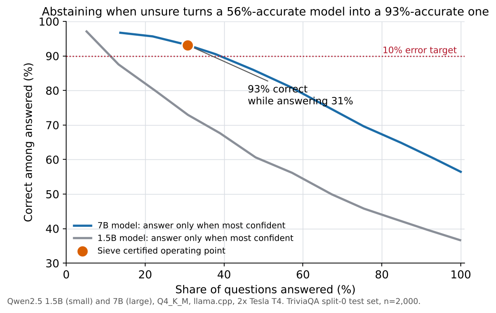
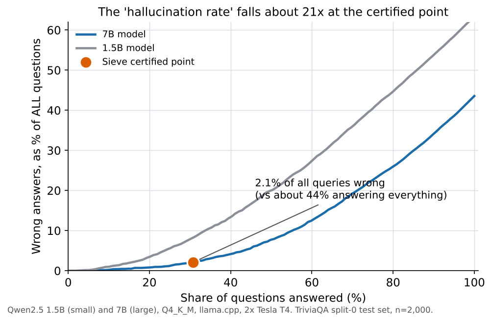
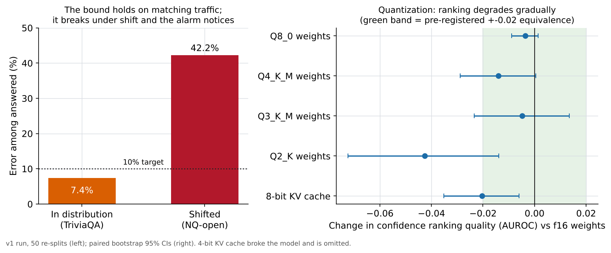
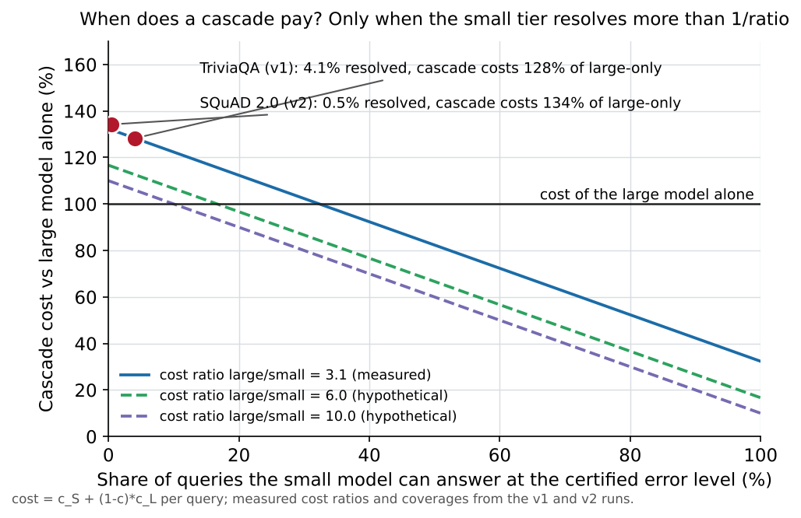
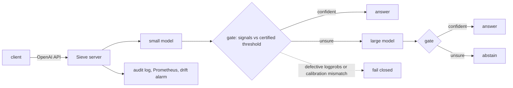

# Sieve

[](https://github.com/sainikethkosaraju/Sieve/actions/workflows/ci.yml)


**A local LLM that knows when not to answer, with an error bound it can prove and a way to check it.**



Sieve sits in front of local models (llama.cpp, Ollama) as an OpenAI-compatible proxy. For every query it decides
to **answer**, **escalate** to a larger model, or **abstain**, using confidence read from the model's own token
probabilities and thresholds certified by Learn-then-Test to a stated error rate. If the logprobs look defective,
or the calibration does not match the model, quantization, prompt or sampler in use, it **fails closed**.

## Results

Measured on two Tesla T4 GPUs with Qwen2.5-1.5B and 7B, in pre-registered runs whose protocol was frozen and
hashed before any data was generated. Full tables, intervals and caveats: **[docs/RESULTS.md](docs/RESULTS.md)**.

| | |
|---|---|
| **21x fewer wrong answers** | On 2,000 held-out TriviaQA questions the 7B model alone is wrong on about 44% of them. Behind the gate, set to a 10% error target, it answered 31% of questions, **93% of them correctly**, so wrong answers fell to **2.1% of all queries** by abstaining on the rest. |
| **The bound held in distribution** | Across 50 independent re-splits, error among answered exceeded the 10% target in 5 (10%; 95% CI 3% to 22%). Mean error was 7.4%. |
| **Shift is detected, not hidden** | On a different question set (NQ-open) the error rose to 42% (50 of 50 re-splits), the documented failure of any marginal guarantee, and the built-in drift alarm fired on all 10 monitoring windows. |
| **Signal quality, measured** | Length-normalised and minimum token logprob beat max-softmax by about +0.03 AUROC; self-consistency sampling was worse and slower. Correctness AUROC reached 0.84 (1.5B) and 0.87 (7B). |
| **Quantization, quantified** | 8-bit and 4-bit weights keep the confidence ranking within about 0.014 AUROC of f16; 2-bit weights and an 8-bit KV cache cost about 0.02 to 0.04. Thresholds fitted at f16 still held the target on every other configuration tested (violated in at most 8.2% of re-splits). |
| **A bug found and reproduced** | llama.cpp drops logprob entries for some multi-token UTF-8 characters (upstream issue 31451). Sieve's startup self-test caught it on the real 7B; affected answers fail closed. |
| **A cost model that explains both runs** | A cascade is cheaper than the large model alone only if the small tier resolves more than `cost_small / cost_large` of queries. It was derived from the first run, written into the v2 pre-registration before the second, and the second measurement agreed. Try it: `python -m sieve.breakeven`. |



## Measured boundaries

These are results too, and they define where Sieve is and is not the right tool.

* **It buys reliability, not compute savings, for this model pair.** At a 10% target the 1.5B model resolved about
  4% of TriviaQA queries and about 0.5% of SQuAD 2.0 queries (a second pre-registered experiment on reading
  comprehension), far below the 32% to 35% break-even, so the cascade cost about 28% to 34% *more* than the 7B alone.
  Use it where a wrong answer costs more than an abstention, not as a cheaper router.
* **The guarantee is marginal.** It holds for traffic that resembles the calibration data, for a frozen model,
  quantization, prompt and sampler, and against a strict exact-match grader. It is not per-query and not a
  statement about truth. Shift breaks it (left panel below), which is why the drift alarm exists.
* **A 4-bit KV cache broke the 1.5B model** in this setup (accuracy 0.0); the gate failed closed on those outputs.





## How it works



The thresholds come from `sieve.calibrate` (fixed-sequence Learn-then-Test on the full two-tier pipeline loss,
exact binomial p-values, hashed artifacts). The decision itself is one pure function, `sieve.gate`, shared by the
server, the evaluation harness and shadow mode, so what was calibrated is exactly what is deployed.

## Try it

```bash
python -m venv .venv && . .venv/bin/activate
pip install -e ".[dev]"
make lint type test          # ruff, mypy (strict), 550+ tests; no GPU or network needed
make reproduce-mock          # synthetic end-to-end pipeline in about a minute
python -m sieve.breakeven --cost-small 0.062 --cost-large 0.192 --resolved 0.04
python scripts/make_figures.py   # regenerate every figure above from results/evidence/
```

Serving (mock backend for a first look): [docs/server.md](docs/server.md). Reproducing the real runs on free
Kaggle GPUs: [docs/kaggle.md](docs/kaggle.md), [docs/reproduce.md](docs/reproduce.md).

## What is in the box

| Package | Purpose |
|---|---|
| `sieve.signals`, `sieve.calibrate`, `sieve.gate` | Confidence signals, selective-risk metrics, Learn-then-Test certification, the pure decision function |
| `sieve.backends`, `sieve.router`, `sieve.server` | llama-server and Ollama adapters with a logprob self-test, the cascade router with full cost accounting, an OpenAI-compatible server (JSON and SSE, backpressure, cancellation) |
| `sieve.observe` | Privacy-by-default audit log, bounded-cardinality Prometheus metrics, drift alarm, shadow mode |
| `sieve.eval` | Pre-registered harness: hash-locked splits, resumable cache, paired bootstrap, McNemar, TOST, hypothesis report |
| `kaggle/` | Drivers that run the whole experiment on free Kaggle T4s and return results through the log |

Quality gates: ruff, mypy strict, and the full test suite pass in CI on Python 3.11 and 3.12. Independent
red-team, evaluation, governance and release audits are recorded in [docs/process/](docs/process/).

## Status and next steps

Released as v0.1.0: the library, server, harness and two pre-registered experiments. Not done yet, and listed in
[docs/ROADMAP.md](docs/ROADMAP.md): serving an evaluation-certified artifact end to end on a real GPU backend
(tested against real captured responses and a mock, not yet against a live pair), per-request backend identity
checks, a judge model for SimpleQA, contamination probes, and a stronger small tier to test whether a cost win is
reachable.

## Models, data and licences

Qwen2.5-1.5B-Instruct and 7B-Instruct are Apache-2.0. Datasets keep their own licences (see [NOTICE](NOTICE)); item
text and generations are not redistributed, only aggregates. MIT licence for the code. Cite via `CITATION.cff`.

> **Disclosure.** Built with substantial AI assistance (Anthropic's Claude, via Claude Code) under the owner's
> direction; commits carry `Co-Authored-By` trailers, and the audit trail is in `docs/process/`. The owner is
> responsible for the project. Background reading under `docs/research/` is AI-assisted and partly unverified.
