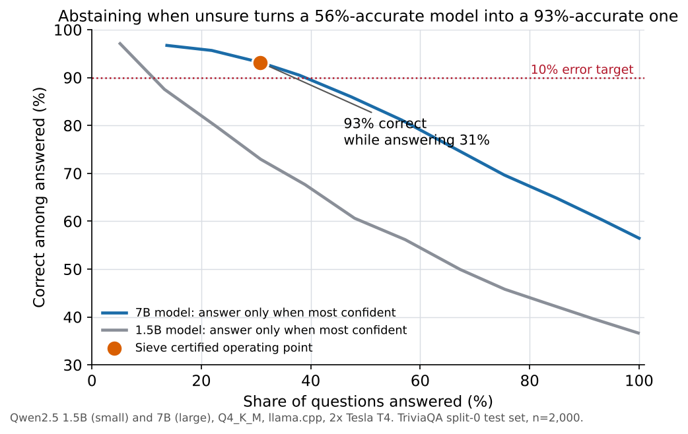
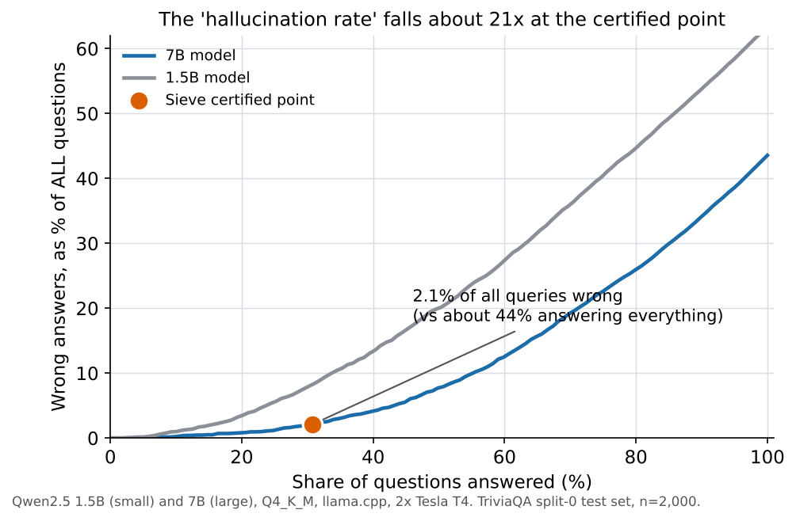
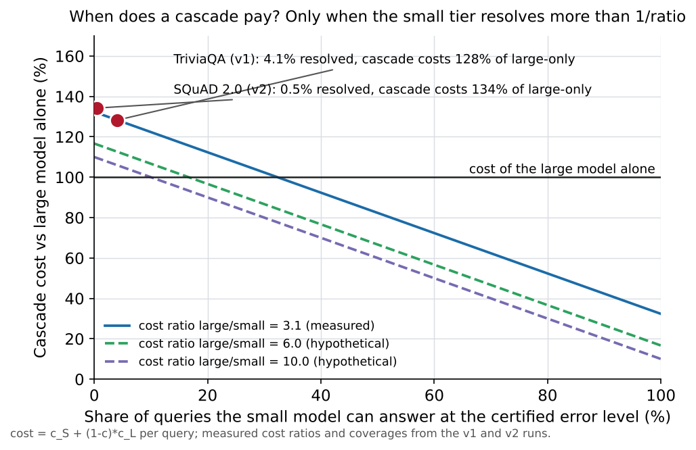
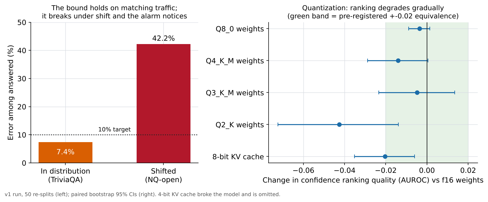

# Results of the first measured run

Everything here is a measurement from one pre-registered run on two Tesla T4s (Kaggle, 2026-11-03).
Raw aggregates: [`results/evidence/t4_main_2026-11-03/`](../results/evidence/t4_main_2026-11-03/).
Protocol: [`PREREGISTRATION.md`](PREREGISTRATION.md) (frozen text unchanged; deviations are dated at the bottom).
Item text, gold answers and generations are not redistributed (dataset licences).

**Setup.** Small tier S = Qwen2.5-1.5B-Instruct Q4_K_M, large tier L = Qwen2.5-7B-Instruct Q4_K_M, both
Apache-2.0, served by llama.cpp (commit `fac3a89`, CUDA 13.0), greedy decoding, fixed few-shot prompt, stop at
the first newline. Data: TriviaQA (6,000 items, 50 hash-locked re-splits into 2,000/2,000/2,000), NQ-open (2,000),
SimpleQA Verified (1,000), MMLU-Redux (1,500). Risk target alpha = 0.10, delta = 0.10. "Wrong" means *graded wrong
by normalised-alias exact match*, a strict grader (see Limitations).

## Headline

**Certified abstention cut the 7B model's wrong answers about 21-fold (from about 44% to 2.1% of all queries) and
the error bound held in distribution; it failed under shift, as any marginal guarantee does, and the built-in drift
alarm noticed. For this model pair the cascade did not save compute: at a certified risk of 10% the small model's
confidence let it answer only about 4% of queries on average across the 50 re-splits (none on the canonical split
0, where the certified small-tier threshold was "never"), so the system behaved like the large model alone plus the
price of the wasted small-model attempt.** The positive result is in the section below; the cost result, and the
break-even model that explains it, are reported as measured.

## The positive result: certified abstention cuts wrong answers

TriviaQA, canonical split 0 test set (n = 2,000), alpha = delta = 0.10, large tier answering through the gate:

| | Answers given | Correct among answered | Wrong answers as a share of ALL queries |
|---|---|---|---|
| 7B alone, no gate | 100% | 55.9% | about 44.1% |
| 7B behind the certified gate | 30.8% (615 of 2,000) | 93.2% | 2.1% (42 of 2,000) |

That is about 21 times fewer wrong answers, paid for with abstaining on about 69% of queries.

 Across the 50
re-splits the gate answered 25.8% on average with a mean error among answered of 7.4% (maximum 12.1%); the error
exceeded 10% in 5 of 50. Caveats: in-distribution only (see H5), one model pair, strict exact-match grading (so
"wrong" includes some correct paraphrases), and the 44% baseline is the large tier's accuracy over all 6,000
TriviaQA items rather than the split-0 test set alone. This is the selective-prediction property the tool is built
for. It is distinct from the cost claim (H3), which failed.

## End-to-end serving demo

The artifact the v1 harness certified on split 0 (`gate:primary`, alpha = delta = 0.10) was mounted in the deployed
server application, with the real 1.5B and 7B backends on the T4s, and 300 fresh TriviaQA validation questions (none
in the experiment's 6,000-item sample) were sent to `/v1/chat/completions`. Evidence:
`results/evidence/serve_demo_2026-11-04/`.

| Served result | Value |
|---|---|
| Answered / abstained | 76 (25.3%) / 224 (reason `low_confidence`) |
| Answered by the large tier | 76 of 76 (the certified small-tier threshold on split 0 is "never") |
| Wrong among answered | 5 of 76 = 6.6% (95% Clopper-Pearson 2.2% to 14.7%; target 10%) |
| Wrong as a share of all questions | 5 of 300 = 1.7% (the 7B alone is wrong on about 44%) |
| Latency per request | mean 0.38 s, p50 0.37 s, p95 0.52 s (2 concurrent requests; includes the small-tier attempt) |
| Mismatch reasons | none: no identity, template-hash or sampling mismatch |

What it establishes: an artifact certified by the evaluation harness is accepted by the serving stack and behaves,
on fresh items from the calibration distribution, in line with its certificate. What it does not: 76 answers give a
wide interval that straddles the target on its upper end; the application was called in-process over ASGI and the
backends were the harness's own (with its stop-sequence and token-trimming handling), not the server's own
llama-server adapter; the server's startup self-test was not re-run (the provider ran it on each backend); and it is
one artifact at one error target. It is a demonstration, not an additional experiment.

## Why the cascade did not pay: a break-even model

The cascade runs the small tier on every query and the large tier on the rest, so per query it costs
`cost_small + (1 - c) * cost_large`, where `c` is the share the small tier resolves at the certified error level. It
is cheaper than the large model alone only if `c > cost_small / cost_large`. Measured cost ratios were 3.1 (TriviaQA)
and 2.9 (SQuAD 2.0), so the small tier had to resolve more than about 32% and 35% of queries; it resolved about 4%
and 0.5%. The same formula says what a winning configuration needs: a small tier that resolves a large share at the
target error, or a much cheaper small tier relative to the large one. `python -m sieve.breakeven` computes it.

## Verdicts on the pre-registered hypotheses

| | Claim | Verdict | Evidence |
|---|---|---|---|
| H1 | Test risk exceeds alpha in <= 15% of re-splits | **Inconclusive** (supported weakly) | 5/50 violations (10%), Clopper-Pearson 95% [3.3%, 21.8%]. Mean test risk 0.074, max 0.121, mean coverage 25.8%, no empty certifications. The rule needs the CI upper bound <= 15%, and 50 dependent re-splits cannot exclude 21.8%. |
| H2 | A token signal beats max-softmax AUROC by >= 0.02 | **Supported, weakly** | min-logprob +0.034 (CI 0.025 to 0.044), mean-logprob +0.029 (0.017 to 0.041). Best of six candidates, no multiplicity correction. First-token and mean-margin signals were worse. |
| H3 | Gated cascade matches L-only at lower cost | **Not supported** | The certified gate answered through L on split 0 (S threshold "never"); cost per correct answer 0.90 s vs 0.68 s for L-only at matched coverage (95% CI of the difference 0.20 to 0.23 s). Across 50 splits: 1.33 s vs 0.79 s. The small tier resolved 4.1% of items on average across the 50 splits and none on split 0. The matched random and query-only routers collapse to the same L-only policy, so those paired differences are exactly zero. |
| H4 | Self-consistency (k=5) adds >= 0.03 AUROC | **Not supported** | -0.054 (CI -0.089 to -0.019) versus the best token signal, on 336 items, at 0.33 s per item versus 0.19 s for L. |
| H5 | Guarantee breaks under shift; drift alarm fires first | **Inconclusive** | NQ-open: risk 0.42 vs alpha 0.10, violated in 50/50 re-splits (CI 0.93 to 1.0); drift alarm fired on 10/10 windows of 200 queries. SimpleQA could not be graded (no independent judge available), so the pre-registered rule cannot reach "supported". |
| H6 | Quantization shifts the gate | **Inconclusive** | See table below. |
| H7 | Gate AUROC < 0.6 on the hard multiple-choice set | **Not supported** | MMLU-Redux (n=1,500): S AUROC 0.792 (95% CI 0.770 to 0.814), L 0.837 (0.816 to 0.857), primary signal mean-logprob. The gate discriminates well on this set. This does not replicate the near-chance result attributed to arXiv 2610.23249 (as read by an earlier research pass, not independently re-verified) on a different benchmark. |

## Accuracy (alias-EM / letter match)

| Dataset | n | Small (1.5B) | Large (7B) |
|---|---|---|---|
| TriviaQA | 6,000 | 0.366 | 0.559 |
| NQ-open | 2,000 | 0.120 | 0.196 |
| MMLU-Redux | 1,500 | 0.595 | 0.743 |
| SimpleQA Verified | 1,000 | ungraded | ungraded |

Correctness AUROC on TriviaQA (split 0 test): S 0.81 (max-softmax) to 0.84 (min-logprob); L 0.85 to 0.87.

## Quantization (H6): effect on the confidence gate, relative to the f16 small model

| Config | Accuracy S (split-0 test slice) | dAUROC (95% CI) | dECE (95% CI) | Violation frequency (share of the 50 re-splits with test risk above 0.10), f16-fitted thresholds transferred |
|---|---|---|---|---|
| Q8_0 weights | 0.379 | -0.004 (-0.009, 0.001) | +0.001 | 0.061 |
| Q4_K_M weights | 0.366 | -0.014 (-0.029, 0.000) | -0.000 | 0.082 |
| Q3_K_M weights | 0.310 | -0.005 (-0.023, 0.014) | +0.003 | 0.082 |
| Q2_K weights | 0.145 | **-0.043** (-0.072, -0.014) | -0.025 | 0.041 |
| Q4_K_M + KV q8_0 | 0.367 | **-0.020** (-0.035, -0.006) | +0.002 | 0.082 |
| Q4_K_M + KV q4_0 | **0.000** | not computed | not computed | 0.041 (meaningless: see below) |

* Ranking quality (AUROC) degrades measurably at 2-bit weights and, more surprisingly, at an 8-bit KV cache.
* Thresholds fitted on f16 and applied to every other configuration had a violation frequency of at most 0.082
  (target 0.10), so in this run quantization moved the ranking more than it moved the guarantee. For the collapsed
  KV q4 arm that number is not meaningful (accuracy 0.0, nearly everything escalates; its recalibrated violation
  frequency was 0.12). Equivalence within the
  pre-registered +-0.02 margin was shown only for Q8_0 weights, hence "inconclusive".
* **In this setup the 4-bit KV cache produced non-terminating, nonsensical output**: 97% of generations hit the
  token limit and accuracy was 0.0 (seen in the run's logged samples, which are not committed). This may be
  specific to this llama.cpp build, its flash-attention path and this model, not a general property of 4-bit KV. Q2_K left 14% of generations unterminated. The gate failed closed on these items as designed.
  An earlier guess that the 4-bit arm's slowness came from a missing build flag was wrong: every item ran to the
  token limit.

## Validity checks that passed

* Stop handling: 99.6% of small-tier and 100% of large-tier headline generations stopped cleanly; token/text
  mismatch rate at most 0.04% (small tier 0.038%, large tier 0%).
* Logprob self-test: the non-ASCII (UTF-8) probe failed for both large-tier cells, because llama.cpp drops logprob
  entries for some multi-token UTF-8 characters (upstream issue 31451). It is advisory in evaluation runs; affected
  items fail closed individually (the large tier had 0 to 1 such items in 10,500).
* Determinism: 600 repeated greedy generations, 0 text flips, maximum logprob difference 0.0 on this build/hardware.
* Splits: hash-locked; split B read once per split; one NQ-open question overlaps TriviaQA (flagged, not removed).

## Limitations (read before citing any number)

* One model family and one small/large pair; short-form QA only; one hardware type (Tesla T4).
* TriviaQA and NQ-open are likely present in pretraining data, so in-distribution confidence is optimistic.
  No contamination probe was run.
* "Risk" is risk of being graded wrong by exact match, which marks correct paraphrases wrong. The grader audit
  (kill test 6) was not run on real outputs.
* The guarantee is marginal, for a frozen configuration, and fails under shift (H5, NQ-open).
* Most hypotheses use one canonical split; the 50 re-splits are dependent resamples. H2 (six candidates) and
  H6 (six configurations) have no multiplicity correction.
* **Cost and energy.** Cost is measured wall time per generation, including wasted attempts. Energy and VRAM were
  sampled but every block was flagged as throttled, and co-resident models in each interleaved group confound
  per-cell VRAM and power. **No "X% of the energy or compute" claim is supported by this run.**
* Not implemented: cross-template transfer, quantization null control, contamination probe, length-bias
  stratification, SimpleQA judging, per-request backend identity checks.

## v2 follow-up: reading comprehension (SQuAD 2.0), pre-registered. Result: negative

Pre-registration: [`PREREGISTRATION_V2.md`](PREREGISTRATION_V2.md), frozen before any real v2 generation. Same two
models, gate, statistics and cost accounting as v1; 6,000 SQuAD 2.0 validation items (answerable and unanswerable
mixed), 50 re-splits, strict exact match with `unanswerable` as the gold for unanswerable items. Evidence:
`results/evidence/v2_squad_2026-11-03/`. The question was whether a task where the answer is in the passage lets
the small model certify enough queries to make the cascade cheaper than the large model alone.

**By the frozen rule, v2 is a negative.**

* **V2-V (validity): not met.** The pre-registered primary gate (the signal is chosen per split by the coded rule)
  was certified in 1 of 50 re-splits; the feasible set was empty in 49. One certified split cannot support a validity claim.
* **V2-P (cost): not met.** No certified gate exists on canonical split 0 (`comparisons.gate_available = false`), so the
  non-inferiority and cost-per-correct comparison cannot be computed.
* The generic hypothesis report refused to run (its guard compares v1's coded criteria with the v1 document), so the
  verdict applies the frozen v2 rule to `analysis/results.json`, using the fields the pre-registration names.

**Context numbers.** Exact-match accuracy: small 0.542, large 0.711. Correctness AUROC of mean log-probability: small
0.669 (95% CI 0.645 to 0.692), large 0.763 (0.741 to 0.785), much weaker than on TriviaQA (0.84 and 0.87). Mean time
per item: small 0.171 s, large 0.493 s, a ratio of 2.9, so the cascade needs the small tier to resolve more than about
35% of queries to break even. Sanity gate passed (clean stops: small 97.1%, large 99.7%); 200 repeated greedy
generations showed no text flips.

**Exploratory, after the fact, not part of the verdict.** The coded rule picked mean-margin as the primary signal in 47
of 50 splits. Gates built on mean log-probability or entropy were certified in 29 and 30 of 50 splits, at about 32%
coverage with mean test risk 7.7% and 7.8% (one split above 10% in each). But their escalation rate was 0.995 and
0.998: the small tier resolved only about 0.5% of queries, so these gates are the 7B model alone plus a wasted
small-model attempt, and with a break-even above 35% there is no cost saving to find.

**Reading (inference).** Moving from trivia to reading comprehension did not make the 1.5B model's confidence
usable: its ranking quality fell, and unanswerable questions in particular draw confident wrong answers. The binding
constraint is the small model's certifiable coverage, not the dataset. A different, stronger small tier is the next
thing to test; this run does not show that it would work.

**Process notes.** A 150-item canary on different items raised the generation limit from 32 to 96 tokens before the
freeze (dated Deviation 1 in the v2 document). The first launch failed after 32 s because the script builder did not
embed the v2 document; it produced no generations, so rerunning was allowed by the rules.

## Reproduce

`docs/reproduce.md` (mock pipeline, no network) and `docs/kaggle.md` (this run). The generation caches are not
committed; they exist in the Kaggle kernel `sieve-t4-main-1`'s output.
